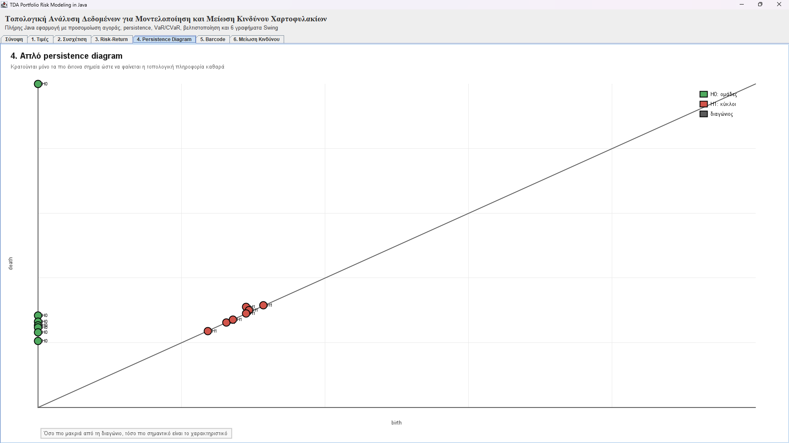
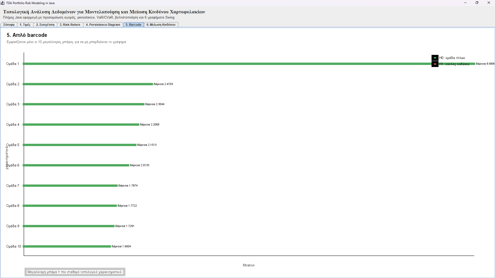
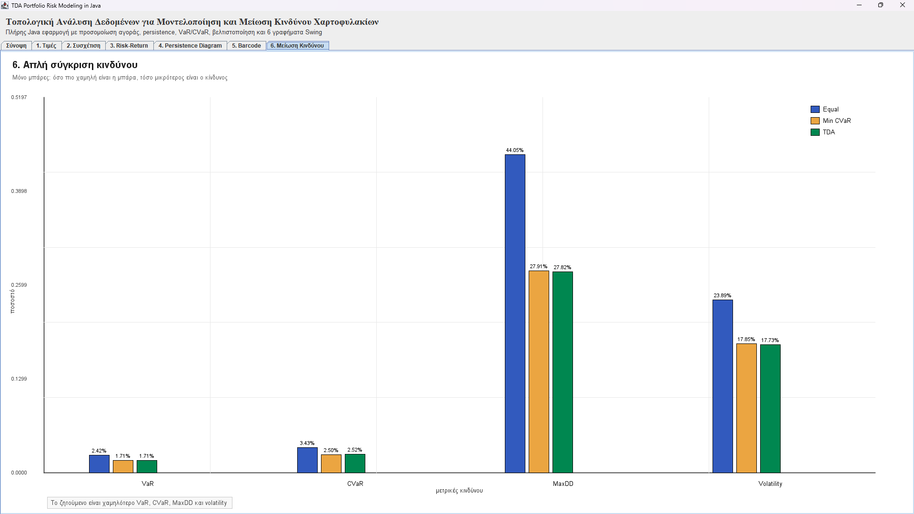

# Portfolio TDA Risk Analyzer

A standalone Java application that applies **Topological Data Analysis (TDA)** — persistent homology over Vietoris–Rips complexes — to financial portfolio risk modeling, and compares it against classical portfolio construction methods.

This is the practical implementation companion to my diploma thesis at the University of Patras, Dept. of Computer Engineering & Informatics:
**"Topological Data Analysis for Modeling and Reducing Risk in Financial Investment Portfolios"** (Margosis, V., 2025/2026, supervisor: Prof. A. Andrikopoulos).

## What it does

The application simulates 12 assets over 756 trading days (~3 market years, covering calm, stressed, recovery, and mature regimes) and builds three competing portfolios:

1. **Equal-Weight** — capital split evenly across all assets (naive baseline).
2. **Min-CVaR** — allocation that minimizes Conditional Value at Risk (tail-risk optimization).
3. **Topology-Aware** — same risk framework, plus a penalty term derived from each asset's position in a Vietoris–Rips persistence diagram (H0/H1 features), so the optimizer avoids over-concentrating in topologically isolated or high-risk assets.

For every asset it computes annualized return/volatility, skewness, kurtosis, VaR(95%), CVaR(95%), max drawdown, and market beta — then feeds these into the TDA pipeline (normalize → pairwise Euclidean distances → Vietoris–Rips filtration → persistent homology via boundary-matrix reduction → persistence diagram / barcode).

The Swing UI shows: price paths, a correlation heatmap, a risk/return scatter plot, the persistence diagram, the barcode, and a side-by-side portfolio comparison panel.

## Sample results (single seeded run)

| Metric | Equal-Weight | Min-CVaR | Topology-Aware |
|---|---|---|---|
| Annual return | 1.58% | 3.22% | **3.74%** |
| Annual volatility | 23.89% | 17.85% | **17.73%** |
| Sharpe ratio | -0.018 | 0.068 | **0.098** |
| VaR (95%, daily) | 2.42% | 1.71% | **1.71%** |
| CVaR (95%, daily) | 3.43% | 2.50% | 2.52% |
| Max drawdown | 44.05% | 27.91% | **27.82%** |

The topology-aware portfolio achieves the best risk-adjusted return (Sharpe) and the lowest max drawdown of the three, without sacrificing return — the central claim of the thesis, reproduced here in code.

*(Note: asset returns are simulated, not pulled from live market data — the goal of this project is to demonstrate the methodology end-to-end, not to predict real security prices.)*

## Screenshots

The application UI is in Greek, as in the thesis.

**Persistence diagram** — H0 (groups of assets) and H1 (loops) as birth/death points. H0 points far from the diagonal indicate strongly separated groups of assets.



**Barcode** — the 10 most persistent bars. A longer bar means a more stable topological feature.



**Risk comparison** — VaR, CVaR, max drawdown and volatility for the Equal-Weight, Min-CVaR and Topology-Aware portfolios.



## Tech stack

Pure Java (JDK 17+), **zero external dependencies** — simulation, statistics, risk metrics, persistent homology, and all charts are implemented from scratch on top of `java.awt`/`javax.swing`.

## Build & run

```bash
javac -encoding UTF-8 -d out src/PortfolioTdaRiskApp.java
java -cp out PortfolioTdaRiskApp
```

Requires a display (it's a desktop Swing app). Tested on OpenJDK 21.

## Project structure

```
portfolio-tda-risk-analyzer/
├── src/
│   └── PortfolioTdaRiskApp.java   # everything: simulation, risk metrics, TDA engine, UI
├── docs/                          # screenshots used in this README
├── README.md
└── LICENSE
```

The single-file structure mirrors the original thesis appendix; classes (`MarketSimulator`, `FeatureExtractor`, `TopologicalAnalyzer`, `PortfolioEngine`, `RiskReportBuilder`, chart panels, etc.) are nested `static` classes with clear single responsibilities — see the file for the full breakdown.

## Background

Full theoretical treatment — persistent homology, Vietoris–Rips/Čech/Alpha complexes, Wasserstein/bottleneck distances, Mapper algorithms, comparison with PCA/Isomap/Laplacian Eigenmaps, and the wider literature review — is in the accompanying thesis document (not included in this repo).

## License

MIT — see [LICENSE](LICENSE).
